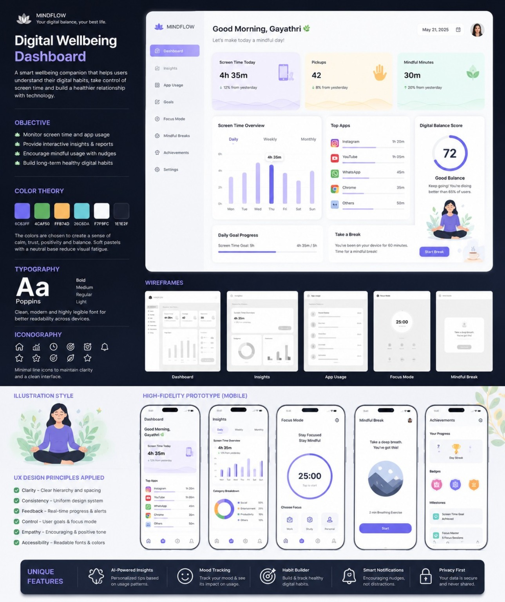

# MindFlow — Interactive Digital Wellbeing Prototype

A responsive, interactive web prototype inspired by my **MindFlow Digital Wellbeing Dashboard** Figma UI/UX design.

## Run it

Open `index.html` in a modern browser. No installation, account, backend, or dependencies required.

To publish online, upload the files to a public GitHub repository, then go to **Settings → Pages → Deploy from a branch → main / root → Save**. GitHub will show the public site address when deployment completes.

## Interactive features

- Dashboard with demo screen-time statistics, progress and visualizations
- Insights and app usage pages
- Editable simulated screen-time and pickup values
- Editable daily screen-time goal
- Focus timer (1, 5, 25, or 45 minutes), pause and reset
- Two-minute mindful breathing break timer
- Achievements unlocked when sessions complete
- Personalizable name and locally saved progress
- Responsive layout for mobile and desktop

## Testing

See [TESTING.md](TESTING.md) for manual test cases. Open the site and perform the steps yourself; test cases are not claims of completed verification.

## Important limitations

This is a **front-end demonstration**, not a native mobile app. The dashboard and app usage figures are **simulated** and do not access real phone usage statistics. Timers run while the tab is open, and may slow down if the browser throttles background tabs. Data is stored only in this browser using `localStorage`.

## Tech stack

HTML, CSS, vanilla JavaScript. Original design made in Figma.

## Credits

UI/UX concept and design: MindFlow Digital Wellbeing Dashboard. `design-reference.jpg` is the supplied Figma design board.
